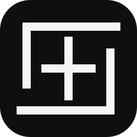
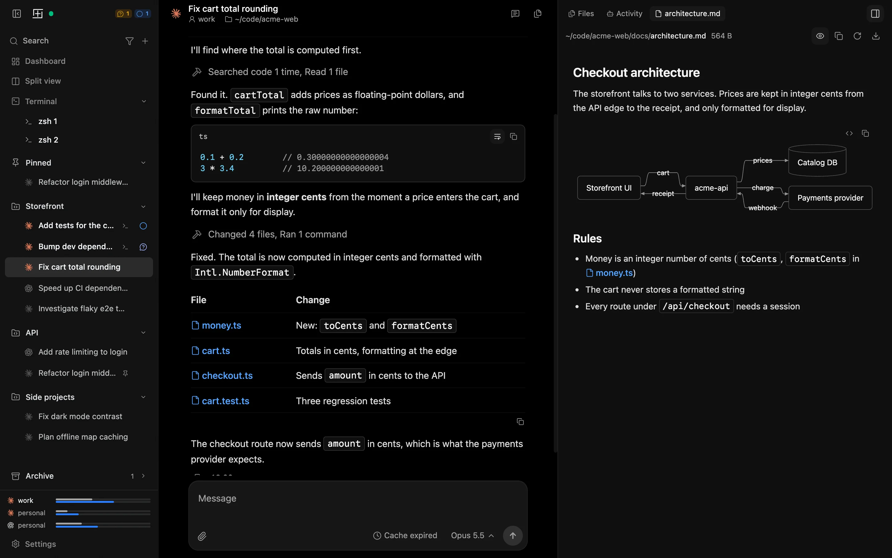
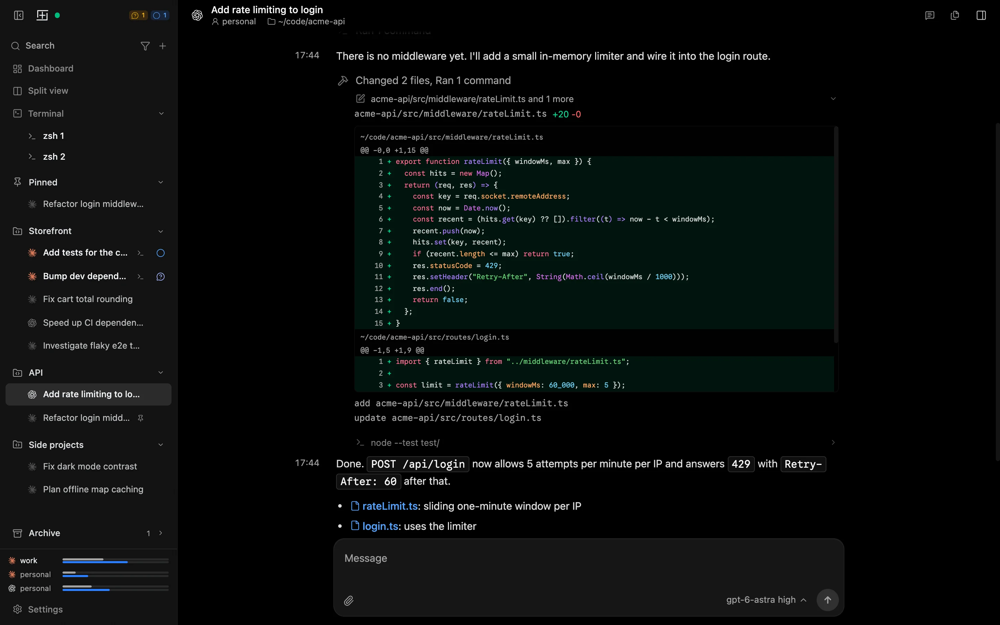
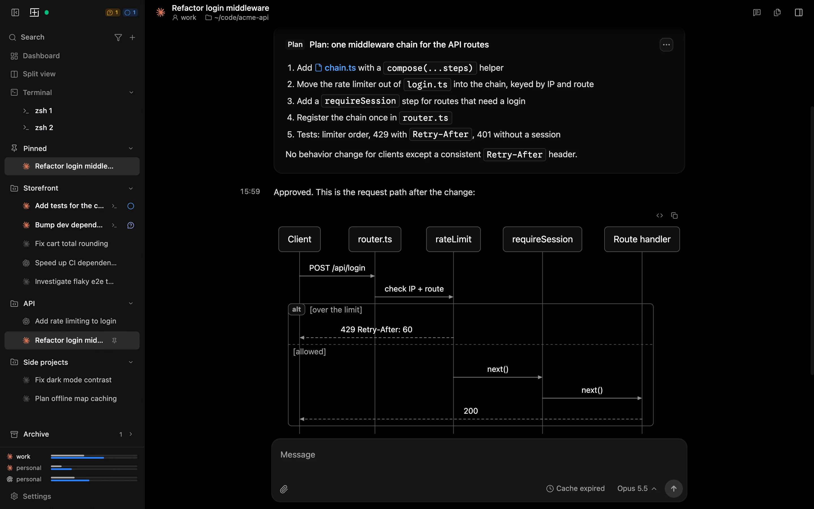
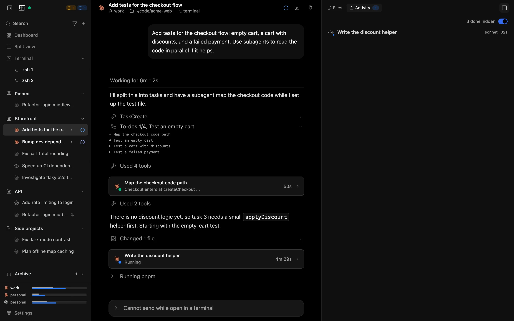
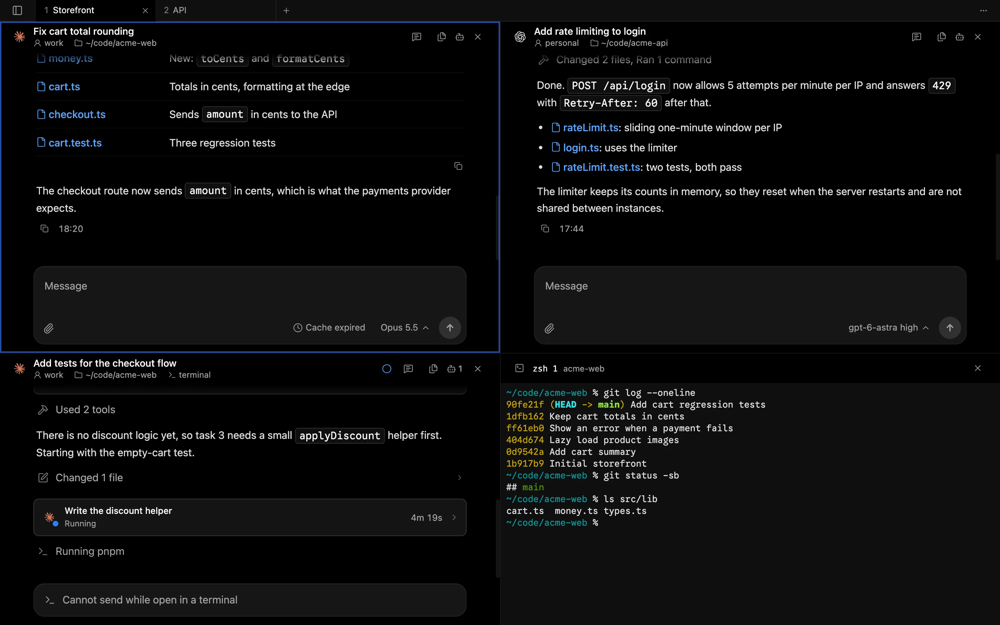
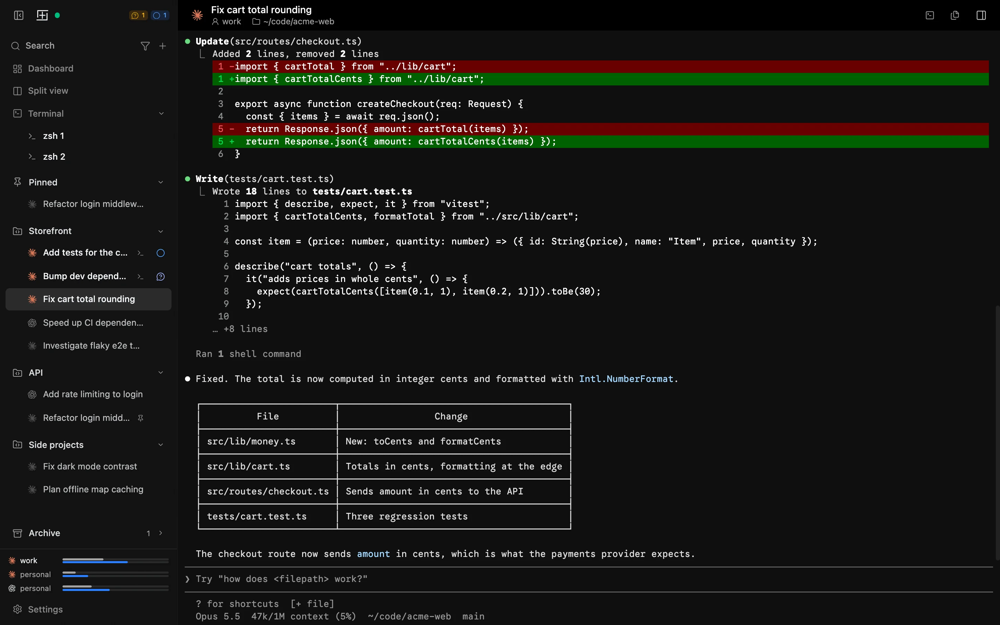
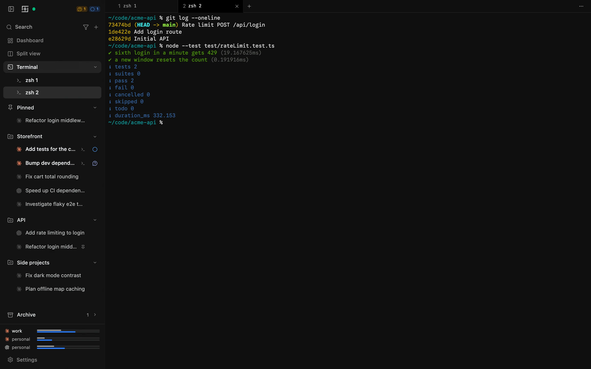
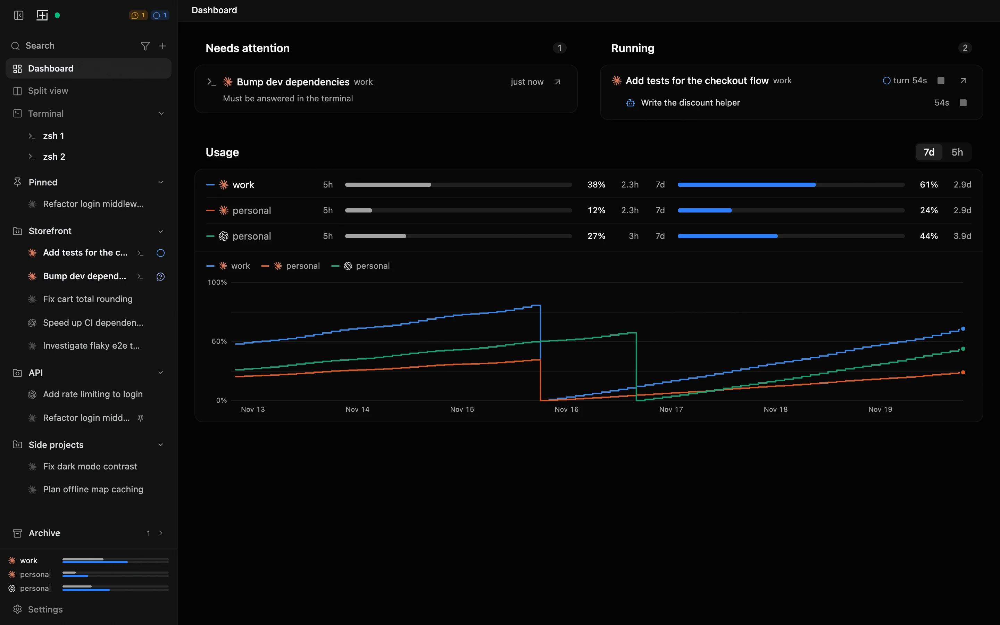
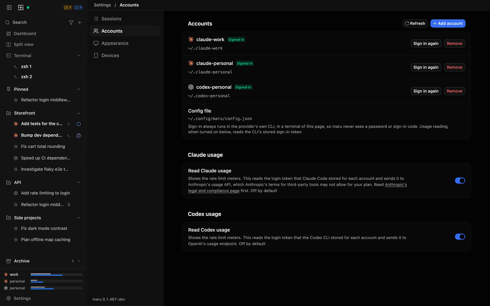

<p align="center">
  
</p>

<h1 align="center">maru</h1>

<p align="center">A local chat UI for the Claude Code and Codex sessions on your Mac, in a browser, a desktop window or an Android app</p>

<p align="center">
  <a href="LICENSE"></a>
  <a href="https://github.com/pu1xar/maru/actions/workflows/ci.yml"></a>
  <a href="https://github.com/pu1xar/maru/releases/latest"></a>
</p>

<p align="center">
  <a href="https://github.com/pu1xar/maru/releases/latest"><strong>Android APK</strong></a>
  &nbsp;|&nbsp;
  <a href="#install"><strong>Install from source</strong></a>
  &nbsp;|&nbsp;
  <a href="#documentation"><strong>Docs</strong></a>
</p>

<p align="center">
  <picture>
    <source media="(prefers-color-scheme: light)" srcset="docs/assets/hero-light.webp" />
    
  </picture>
</p>

## What is maru

maru is a small server on your Mac and a web UI on top of it. It shows the sessions of your Claude Code and Codex accounts in one window: the ones you start in maru and the ones you started in a terminal.

- It reads the transcripts and daemons that the two CLIs already keep, so a session started in a terminal appears in the list and updates live. A session a terminal still has open is shown read only, and a stopped one can be continued from maru
- Sessions started from maru run through the official Claude Agent SDK (Claude) and the Codex app-server (Codex), with permission prompts turned off. Treat the server like a shell on your machine (see [Security model](#security-model))
- You sign in to the unmodified CLIs with your own accounts, and maru never receives your password or sign-in code. Only the optional usage switches read the tokens the CLIs stored (see [Authentication and Anthropic's terms](#authentication-and-anthropics-terms))

maru is a single-user tool, built for one person on one Mac. It is published as is, without a support promise. The UI language is English.

The screenshots on this page come from an isolated instance with made-up sessions ([scripts/screenshots](scripts/screenshots/capture.mjs)).

## Features

<table>
<tr>
<td width="50%" valign="middle">

### Claude Code and Codex in one list

Sessions of every configured account, grouped into your own Groups, with Pinned and Archive sections. Each row shows its live status (Running, Waiting for input, Open, Closed, Error) and whether maru or a terminal holds it. "Add existing session" picks sessions from your accounts, and "Remove from list" leaves the session files alone.

</td>
<td width="50%">
  
</td>
</tr>
<tr>
<td width="50%" valign="middle">

### The whole conversation

Markdown, code highlighting, tool calls grouped into rows that open, diffs with line numbers, plan cards, Mermaid diagrams and images. The composer has slash commands, attachments (paste, drop, file picker), model and effort pickers, and the question, plan and approval panels of both agents.

</td>
<td width="50%">
  
</td>
</tr>
<tr>
<td width="50%" valign="middle">

### Subagents and tasks

Subagent cards open the subagent's own conversation. The task list shows where a turn stands, and the Activity tab in the right panel lists the subagents, workflows and background commands that are still running, with Stop and Resume.

</td>
<td width="50%">
  
</td>
</tr>
<tr>
<td width="50%" valign="middle">

### Split view

Drag sessions and shells from the sidebar into panes, side by side or stacked, and keep several layouts as tabs. Keyboard shortcuts split, move between and close panes. A session dragged out of the app window opens in its own small window.

</td>
<td width="50%">
  
</td>
</tr>
<tr>
<td width="50%" valign="middle">

### Terminal mode

The same conversation drawn like the Claude Code CLI, with its tool blocks, diffs and status line. Switch per session with the button in the header (⌥⌘T), or make it the default in Settings, Appearance.

</td>
<td width="50%">
  
</td>
</tr>
<tr>
<td width="50%" valign="middle">

### Shells

Shells (the Terminal section of the sidebar) on a tmux server of maru's own, attached through xterm.js. They survive a restart of the web server and can be opened in split view next to a session (⌘J opens the shells, ⌘⇧J a new one).

</td>
<td width="50%">
  
</td>
</tr>
<tr>
<td width="50%" valign="middle">

### Dashboard and usage

Needs attention (questions, sessions waiting for input, errors), Running (turns, subagents and workflows with Stop) and Usage: the 5-hour and 7-day rate limits of each account with a 7-day trend. Usage reading is off by default (see [Configuration](#configuration)).

</td>
<td width="50%">
  
</td>
</tr>
<tr>
<td width="50%" valign="middle">

### Accounts

Settings, Accounts lists every Claude and Codex account with its folder and login status. Add account writes the config file, creates the folder and opens a shell with the CLI's own sign-in command typed in. Several accounts of one provider work side by side.

</td>
<td width="50%">
  
</td>
</tr>
</table>

**Also included**

- Queue: messages sent while a turn runs wait in a queue and can go back to the input. For a Claude session that maru runs, "Send now" (Esc) hands the queued message to the running turn
- "Rewind to here" (conversation, code or both) and "Fork from here" on any of your messages
- Search: "Find in conversation" (⌘F) inside a session, and the sidebar search across every session's conversation
- Right panel: a Files tab with a file tree and file previews (Markdown and Mermaid rendered), and the Activity tab
- Session management: rename, "Move to another account", "Change working folder" (Claude), "Copy resume command", and deleting in Settings, Sessions (a session over 1 MB goes to a trash with restore, a smaller one is removed for good)
- Appearance: System, Light and Dark themes, fonts and sizes per area
- [Android app](#android-app): the session list, conversations, shells and search, paired by QR code, with over-the-air updates served by your own server and optional push notifications through your own Firebase project
- [Desktop app](#desktop-app): the web UI in its own Electron window, for macOS and Windows, paired like the Android app and kept current by signed self-updates. You build and sign it yourself

## Install

maru runs from a checkout of this repository. There is no installer for the server.

### Requirements

| What | Version | Needed for |
|---|---|---|
| macOS | - | maru is developed and tested on macOS only (see the notes below) |
| Node.js | 26 or newer | the server, the host and the build |
| pnpm | 9 (the repository pins `pnpm@9.15.0` in `package.json`) | installing and running |
| Claude Code CLI | signed in | Claude sessions |
| Codex CLI | signed in, with its app-server daemon running (`codex remote-control start`) | Codex sessions |
| tmux | - | shells |
| Android Studio (its bundled JBR) and the Android SDK, Node with npm | - | building the Android app yourself only |

- Code that assumes macOS: the folder picker (`osascript`), reading Claude Code credentials from the login Keychain (`security`), the `~/.Trash` stub folder, Keychain storage of the desktop pairing, and the Android build defaults (Android Studio on macOS)
- Linux may run the core (the server, host and web UI use `ps`, `pgrep`, `lsof` and unix sockets) but has not been tried. Windows is supported only as a target of the desktop app, not for the server
- maru finds the Claude CLI in this order: `claudeBin` in the config file, `claude` on the `PATH` of the server, then `~/.local/bin/claude` (where the native installer puts it)
- A Codex account without a running daemon is read from its state database and cannot be driven

### Quick start

1. Install the dependencies

   ```sh
   pnpm install
   ```

2. Build the web UI

   ```sh
   pnpm build:web          # writes apps/web/dist
   ```

3. Start the Claude session host in one terminal

   ```sh
   pnpm host
   ```

   The host is a separate process that owns the Claude CLI child processes, so restarting the web server does not interrupt running turns. Without it the server still lists and reads sessions, and sending to a Claude session answers with an error.

4. Start the server in another terminal

   ```sh
   pnpm start
   ```

5. Open http://127.0.0.1:8024

The server binds to `127.0.0.1` only. The port is 8024, or the `PORT` environment variable.

### First run

The session list starts empty: maru lists only the sessions you choose.

1. Open Settings (bottom of the sidebar), Accounts. maru detects `~/.claude` and `~/.codex` when they exist. Each account shows Signed in, Not signed in, CLI not found or Unknown
2. To add an account, press Add account, choose the provider, an id and a folder, and finish the CLI's sign-in in the shell that opens. Press Refresh, then restart maru (the server reads its accounts at start)
3. In the sidebar, press Add (the plus button) and choose "Add existing session" to search your accounts' sessions and pick the ones to show, or "New session" to start one from maru
4. Optional: the usage switches on the Accounts page turn on the rate-limit meters. Read [Authentication and Anthropic's terms](#authentication-and-anthropics-terms) first

## Android app

The Android app is a separate native app, not the web UI in a wrapper. It needs your maru server reachable over HTTPS.

1. Download `maru-<version>.apk` from the [latest release](https://github.com/pu1xar/maru/releases/latest) on your phone (package `dev.maru.app`, a `.sha256` file sits next to it) and open it
2. On the Mac, set `MARU_DEVICE_PORT` (for example `8025`) and start an HTTPS tunnel to that port. Tailscale Serve is the recommended choice, since the address stays inside your tailnet
3. Set `MARU_DEVICE_URL` to the tunnel's `https://` address and `MARU_DEVICE_HOSTS` to its host name, then restart maru
4. In the web UI, open Settings, Devices, press Connect Android and scan the QR code with the app

The device listener binds to `127.0.0.1`, so a plain LAN address does not work. The app reads the repository's latest release at start and once a day, and shows a Download button when a newer APK exists. The full steps, Cloudflare and ngrok alternatives, and building the APK yourself are in [docs/android.md](docs/android.md).

## Desktop app

The desktop app is an Electron window that opens the web UI of the server it is paired with, for macOS and Windows. This repository publishes no desktop build: you build the installers yourself and sign the update manifest with your own key.

```sh
pnpm --filter @maru/desktop start       # bundles and runs the app in development
node apps/desktop/scripts/build.ts --out <dir> --targets mac-arm64   # installers and a signed update manifest
```

On macOS the build uses no Apple Developer ID. It signs with a local self-signed certificate in your login Keychain, or ad hoc without one. Targets, keys and the certificate are in [docs/desktop.md](docs/desktop.md).

## Configuration

maru reads `~/.config/maru/config.json`. Set `MARU_CONFIG` to use another path. Every field is optional, and `~` expands to your home folder.

```json
{
  "claudeAccounts": [{ "id": "claude", "dir": "~/.claude" }],
  "codexAccounts": [{ "id": "codex", "home": "~/.codex" }],
  "claudeBin": "~/.local/bin/claude",
  "claudeUsage": false,
  "codexUsage": false
}
```

- `claudeAccounts[].dir` is the `CLAUDE_CONFIG_DIR` of an account, `codexAccounts[].home` is its `CODEX_HOME`. Without a file, maru detects `~/.claude` and `~/.codex`
- `claudeUsage` and `codexUsage` (both off by default) turn on the usage meters. They read the CLIs' stored login tokens and call undocumented endpoints, see [Authentication and Anthropic's terms](#authentication-and-anthropics-terms)
- State lives in `~/.config/maru/` (`state.sqlite`, the session host socket, the shell tmux socket, the trash and uploaded attachments)

Every field, the Accounts page, and the environment variables for ports, state paths and builds are in [docs/configuration.md](docs/configuration.md).

## Authentication and Anthropic's terms

maru does not handle Claude logins. Each user signs in to the unmodified Claude Code CLI with their own account, and maru drives that CLI through the Claude Agent SDK.

```sh
claude auth login            # a Claude subscription
claude auth login --console  # an Anthropic Console account (API billing)
```

### What the terms say

Anthropic's [legal and compliance page](https://code.claude.com/docs/en/legal-and-compliance) says, under "Acceptable use":

> Advertised usage limits for Pro, Max, and Ultra plans assume ordinary, individual usage of Claude Code and the Agent SDK.

and, under "Authentication and credential use":

> Developers building products or services that interact with Claude's capabilities, including those using the Agent SDK, should use API key authentication through Claude Console or a supported cloud provider. Anthropic does not permit third-party developers to offer Claude.ai login into their own applications, or to route requests through Free, Pro, Max, or Ultra plan credentials on behalf of their users. Moreover, developers may not collect, store, or intermediate Claude.ai credentials or session tokens

and, in the same text, that this does

> Nor does it prevent an end user from signing in to the unmodified Claude Code binary with their own Claude subscription

### How maru reads this

- maru is a program built on the Agent SDK, so the first sentence (API key authentication for developers) applies to maru's author and to anyone who redistributes maru as a product or service
- maru is meant for the case of the last quote: you, an end user, sign in to the unmodified Claude Code binary with your own Claude subscription, on your own machine, and maru drives that binary
  - maru does not offer Claude.ai login, does not receive or store your login, and does not route anyone else's requests through your plan
  - The use is meant to be ordinary and individual: one person, one Mac, sessions that person starts
- This is an interpretation, and the wording leaves room for another one: a tool that wraps the Agent SDK around a subscription login can be read as "building a product that interacts with Claude's capabilities", and Anthropic can change the text or enforce it without notice. Using a subscription with maru, and what follows for your account, is your decision and your responsibility
- When you are not sure, use API billing (`claude auth login --console`, or a supported cloud provider through the CLI's own settings) instead of a subscription, or ask Anthropic ([contact sales](https://www.anthropic.com/contact-sales))
- Do not use maru to host sessions for other people. It is a single-user tool and it has no user accounts

### API billing and the usage switches

- API billing: the CLI's Console login (`claude auth login --console`) stores its credentials in the account's config directory. maru starts the CLI with a fixed, minimal environment (`HOME`, `USER`, `PATH`, `LANG`, `SHELL`, `CLAUDE_CONFIG_DIR` and a few more), so an `ANTHROPIC_API_KEY` set in the server's environment does not reach the CLI
- `claudeUsage` reads the OAuth token that Claude Code stored (login Keychain on macOS, or `.credentials.json` in the config directory) and sends it to `https://api.anthropic.com/api/oauth/usage` to read the 5-hour and 7-day usage windows
  - The request carries `User-Agent: claude-code/<version>`, with the version of your installed CLI, so it looks like the requests Claude Code makes itself (`apps/server/src/usage/claude.ts`)
  - The endpoint is not a documented API, and the token belongs to Claude Code. The switch is off by default. Turning it on is your decision and your responsibility
- Codex: sessions run through the Codex CLI's own app-server and its own sign-in, which maru does not read
  - `codexUsage` is the exception. It first asks the Codex app-server (`account/rateLimits/read`), which needs no token from maru. When no app-server answers for that home, it reads the login token in `<CODEX_HOME>/auth.json` and calls OpenAI's private endpoint `https://chatgpt.com/backend-api/wham/usage` with the Codex CLI's `User-Agent`, and after that the last rate-limit snapshot in a session rollout. The endpoint is not a documented API, and this README does not review OpenAI's terms for it. The switch is off by default. Turning it on is your decision and your responsibility

## Security model

maru starts agents with permission prompts off (Claude with `bypassPermissions`, Codex with approval policy `never` and full filesystem access) and opens shells. Whoever can use the UI can run commands as your user.

- The web listener binds to `127.0.0.1` and has no login. Every process and every OS user on this Mac can reach it. Its `Host` and `Origin` checks stop web pages (DNS rebinding, cross-site requests), not local programs
- The Android and desktop apps use a second listener, the device listener (`MARU_DEVICE_PORT`, off by default, bound to `127.0.0.1` as well). A one-time pairing code is exchanged for a device token, and the server stores only SHA-256 hashes of both
- The session host listens on a unix socket in `~/.config/maru/` with mode 0600, and it is a command execution path for your user
- To reach maru from outside the machine, put it behind a reverse proxy that you configure, that serves HTTPS and that authenticates users first. Without your own authentication in front, anyone who can reach the web port controls the agents

The full model, with the pairing flow, token scopes and the reverse proxy setup, is in [docs/security.md](docs/security.md). To report a vulnerability, see [SECURITY.md](SECURITY.md).

## Documentation

- [Configuration](docs/configuration.md): the config file, the Accounts page and every environment variable
- [Android app](docs/android.md): installing the APK, reaching the server from the phone, building it yourself, update signing keys
- [Desktop app](docs/desktop.md): building, signing and pairing the Electron app
- [Security model](docs/security.md): listeners, pairing, tokens and remote access
- [Architecture](docs/ARCHITECTURE.md): how the server, the session host and the clients fit together
- [Android build and release](apps/mobile/README.md) and [push notifications](apps/mobile/FCM-SETUP.md)

## Development

```sh
pnpm typecheck          # server, web and desktop (tsc)
pnpm test               # node --test over server, web, shared, desktop and scripts

cd apps/mobile
npx tsc --noEmit -p .
node --test 'src/**/*.test.ts' 'scripts/**/*.test.mts'
```

The mobile tests compare generated bundles with the packages that `apps/web` installs, so run `pnpm install` at the root first. GitHub Actions runs the same commands on macOS (`.github/workflows/ci.yml`).

Development with hot reload runs two processes. The Vite dev server proxies `/api` and `/ws` to the server (`MARU_PORT` names the server port when it is not 8024).

```sh
MARU_ORIGINS=http://localhost:5173,http://127.0.0.1:5173 pnpm dev:server
pnpm dev:web            # http://127.0.0.1:5173
```

The screenshots in `docs/assets` are made by `node scripts/screenshots/capture.mjs` after `pnpm build:web`. It starts an isolated maru on a scratch home folder with made-up sessions, stand-in CLIs and a stand-in Codex daemon, and drives headless Chromium. The header of the script lists its options.

## Project layout

```text
apps/server       Node 26 server, runs TypeScript directly (type stripping)
  src/claude        Claude transcripts, session index, driver, projection
  src/codex         Codex app-server connection, index, projection, generated protocol types
  src/host          Claude session host process and its socket protocol
  src/http          web listener, Host and Origin guard
  src/devices       pairing, device tokens, device listener
  src/shell         shell terminals (tmux and node-pty)
  src/usage         usage readers
apps/web          React and Vite web UI
apps/desktop      Electron app and its build scripts
apps/mobile       Expo Android app (own npm package root)
packages/shared   types and pure helpers shared by all of the above
scripts           version, host maintenance, performance and screenshot scripts
docs              user guides, architecture notes and README images
patches           pnpm patches for two npm packages
```

## Contributing

maru is a personal project and pull requests are reviewed when there is time. Open an issue first, keep a pull request small, and run the checks above. [CONTRIBUTING.md](CONTRIBUTING.md) has the details.

## License

MIT, see [LICENSE](LICENSE). Third-party code and bundled files, with their licenses, are listed in [THIRD_PARTY_NOTICES.md](THIRD_PARTY_NOTICES.md).
